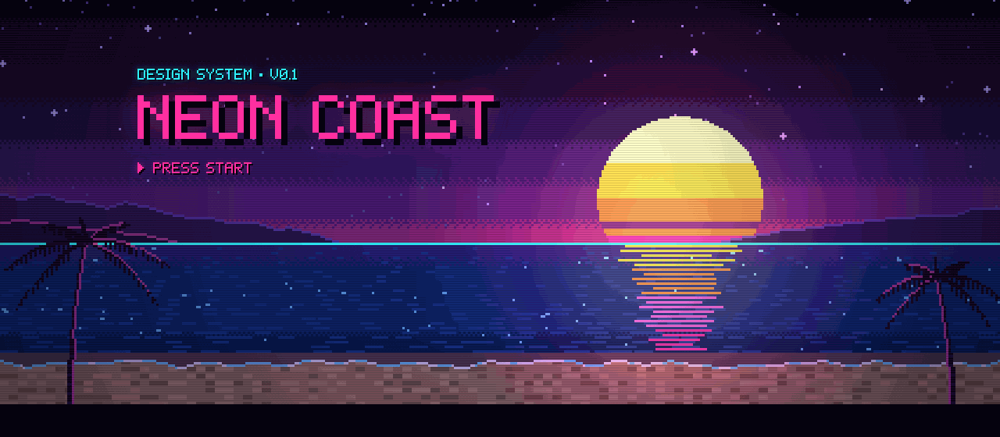
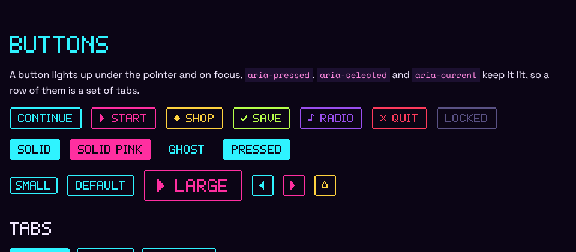

# Neon Coast

The pixel look of [phareim.no](https://phareim.no) as a design system: the
night palette, the 5×7 pixel letters, the dialog box with its notched
corners, buttons that light up, and the coast at dusk with the sun stuck on
the horizon.



It comes in three layers, and you only take what you need:

| Layer | File | What it does |
|---|---|---|
| **CSS** | `dist/neon-coast.css` | One file, no build step. Styles plain HTML inside `class="nc"`, plus `.nc-*` components. The pixel font is inside it. |
| **Elements** | `dist/neon-coast.js` | `<nc-scene>` (the coast as a live backdrop) and `<nc-sprite>` (pixel art written in the page). No code needed. |
| **Canvas kit** | `dist/neon-coast.js` | The pixel stage with its light map, string-map sprites, the 5×7 font, scenery painters and HUD shapes — for games. |

Open `index.html` (the style guide) or the two examples in `examples/` to see
all of it: `npm run serve` and then <http://localhost:5173/>.

## Start

Two lines and a class:

```html
<link rel="stylesheet" href="https://cdn.jsdelivr.net/gh/phareim/neon-coast@master/dist/neon-coast.css">
<script type="module" src="https://cdn.jsdelivr.net/gh/phareim/neon-coast@master/dist/neon-coast.js"></script>

<body class="nc">
  <nc-scene scene="coast" style="height: 320px"></nc-scene>
  <main>
    <h1>Hello, coast</h1>
    <div class="nc-box">A dialog box.</div>
    <button>▶ Start</button>
  </main>
</body>
```

The script line is only for `<nc-scene>`, `<nc-sprite>` and the canvas kit;
the CSS works alone. Pin a version by swapping `@master` for a tag or a
commit once one exists.

### With npm (Vue, Nuxt, React, Vite …)

```bash
npm install github:phareim/neon-coast
```

```js
import 'neon-coast/css'          // the look
import 'neon-coast'              // registers <nc-scene> and <nc-sprite>
import { createPixelStage, sprite, drawText } from 'neon-coast'   // the canvas kit
```

Nuxt: add the CSS in `nuxt.config.ts` and load the elements on the client
only, and tell Vue that `nc-*` tags are custom elements:

```ts
// nuxt.config.ts
export default defineNuxtConfig({
  css: ['neon-coast/css'],
  vue: { compilerOptions: { isCustomElement: tag => tag.startsWith('nc-') } },
})

// plugins/neon-coast.client.ts
import 'neon-coast'
export default defineNuxtPlugin(() => {})
```

The module imports fine on a server (it registers nothing there), and it
ships TypeScript declarations.

## The rules

These are what make it look like Neon Coast. Keep to them and new screens
will fit.

1. **Pixel letters at 8 px steps only** — 8, 16, 24, 32, 48, 64. One font
   pixel is an eighth of the size; anything else blurs. Line heights of
   1.25 or 1.5 keep the baseline on a whole pixel.
2. **Pixel letters for the interface, Space Grotesk for prose, Space Mono
   for code and typing.** The pixel font has capitals only, so long text
   belongs in the body face.
3. **One edge, one unit.** Framed things have a 2 px (`--nc-u`) edge with
   open corners. No `border-radius`, no soft drop shadows — only the hard
   shadow one font pixel down-right, and the neon glow.
4. **Colour has a job.** Cyan is the interface. Pink is the call to action,
   and *you*. Gold is treasure. Lime, orange and red are for status.
5. **Things blink in steps; they never slide or fade.** Backgrounds may
   move, chrome does not. Reduced motion stops the blinking and the scenery.

## Tokens

Everything is a CSS custom property on `:root`, generated from
`src/js/tokens.js` (also in `dist/tokens.json`), so the canvas and the CSS
share one palette.

**Roles** — change these to retint an area: set `--nc-accent` on a section
and every box, button and field inside follows.

| Token | Colour | For |
|---|---|---|
| `--nc-bg` | ink `#0b0616` | the page |
| `--nc-accent` | cyan `#2ff3ff` | the interface: edges, links, HUD text |
| `--nc-hot` | pink `#ff2fa0` | call to action, you, titles |
| `--nc-prize` | gold `#ffd23f` | treasure, the podium |
| `--nc-ok` / `--nc-warn` / `--nc-danger` | lime / orange / red | status |
| `--nc-text` / `--nc-text-muted` / `--nc-text-subtle` | `#f2e9ff` / `#b9a8d9` / `#8f86b8` | text |
| `--nc-surface` | ink at 88 % | panel fill |
| `--nc-field` | `#140b26` | inside inputs and meters |
| `--nc-quiet` | `#6a5aa8` | quiet edges (fields at rest, frames) |
| `--nc-rule` | `#54259e` | dividers |

**Palette** — each colour is `--nc-<name>` and a sprite letter:
ink `k`, night `K`, dusk `u`, slate `G`, haze `g`, lavender `W`, white `w`,
cyan `c`/`C`, blue `b`/`B`, pink `p`/`P`, rose `m`, violet `v`/`V`,
gold `y`/`Y`, cream `e`, orange `o`, red `r`/`R`, lime `l`/`L`,
teal `t`/`T`, plum `h`/`H` (the capital is the `-deep` shade). Sprites also
have skin `s S`, wood `n N` and clay `a i j`. The dusk ramps are
`--nc-sky-0` … `--nc-sky-7` and `--nc-sun-0` … `--nc-sun-3`.

**Scales** — `--nc-u` (2 px), `--nc-size-0` … `--nc-size-5` (8 → 64 px),
`--nc-space-1` … `--nc-space-8` (4 → 64 px), `--nc-font-pixel`,
`--nc-font-body`, `--nc-font-mono`, `--nc-font-input`, `--nc-wrap` (960 px).

Every text colour passes WCAG AA on the night background (subtle text is
6:1, pink 5.9:1); edges that mark a control are at least 3:1.

## Classless

Inside `class="nc"`, plain elements need no classes: headings (pink `h1`,
cyan `h2`, white `h3`), links, lists with square cyan bullets, `blockquote`,
`code`, `pre`, `kbd`, `mark`, `hr`, `table`, `button`, every `input`,
`select`, `textarea`, `fieldset`, `progress`, `details` and `dialog`. On
`<body class="nc">` the body's own `header`, `main` and `footer` become a
centred column.

All of it sits inside `:where()`, so it has no specificity: any class — a
`.nc-*` component or your own — wins without `!important`. Put `nc` on a
smaller container if only part of a page should take the look.

## Components

| Class | What | Variants |
|---|---|---|
| `.nc-box` | the dialog box: dark panel, edge, faint cyan rule inside the top | `--pink` `--gold` `--lime` `--violet` `--quiet` `--flat` `--solid` |
| `.nc-dialog` | what people say: white pixel letters in a pink box; works on `<dialog>` | add `<span class="nc-more"></span>` for the blinking ▼ |
| `.nc-alert` | a status line in a box | `--ok` `--warn` `--danger` |
| `.nc-frame` | the edge alone, for images, avatars and canvases | `--gold` `--pink` `--cyan` |
| `.nc-btn` | lights up on hover and focus; stays lit with `aria-pressed`, `aria-selected`, `aria-current` or `.is-active` | `--pink` `--gold` `--lime` `--violet` `--red` · `--solid` `--ghost` · `--sm` `--lg` `--icon` `--block` |
| `.nc-btns`, `.nc-tabs` | a row of buttons; tabs are buttons with `aria-selected` | |
| `.nc-field`, `.nc-label`, `.nc-help` | a form row: label, control, small print | |
| `.nc-input`, `.nc-textarea`, `.nc-select` | fields: dark wells, quiet edge, cyan on focus, red when invalid | `.nc-input--pixel` for name entry |
| `.nc-check`, `.nc-radio`, `.nc-switch`, `.nc-range` | checkbox, radio, on/off (`role="switch"`), slider | `.nc-choice` for a label with a control in front |
| `.nc-meter` | a bar that fills in whole cells: `style="--nc-value: .6"` | `--pink` `--gold` `--lime` `--red` `--fluid`; `--nc-cells`, `--nc-cell` |
| `.nc-badge` | a small solid tag | `--pink` `--gold` `--lime` `--violet` `--red` `--quiet` `--outline` |
| `.nc-kbd` | a key cap | |
| `.nc-menu` | a list of choices with the ▶ cursor (`aria-current` marks one) | |
| `.nc-table` | the high-score table, all pixel letters | rows `.is-hot` (you) and `.is-prize` (podium); cells `.nc-num` |
| `.nc-details` | disclosure with ▶ / ▼ | |
| `.nc-rule` | a divider | `--dots` `--neon` |

**Text:** `.nc-pixel` (the pixel font on anything), `.nc-prose` (back to
the body face), `.nc-title` (big pink title with shadow and glow),
`.nc-hud` (cyan interface text), `.nc-hint` (pink call to action),
`.nc-banner` (white letters between a cyan and a pink line), `.nc-dim`,
`.nc-blink`, `.nc-loading` (dots that count up), `.nc-drop`, `.nc-glow`,
`.nc-size-0` … `.nc-size-5`, and colour classes `.nc-cyan` `.nc-pink`
`.nc-gold` `.nc-lime` `.nc-violet` `.nc-orange` `.nc-red` `.nc-white`
`.nc-muted` `.nc-subtle`.

**Scenery in CSS:** `.nc-sky` (the dusk in hard bands), `.nc-sun` (the
striped sun on a horizon; `--nc-sun-size`), `.nc-horizon` (a cyan line with
the sea under it), `.nc-crt` (scanlines and a vignette over anything),
`.nc-pixelated` (nearest-neighbour scaling for pixel-art images).

**Layout:** `.nc-page`, `.nc-wrap`, `.nc-stack`, `.nc-cluster`, `.nc-grid`
(`--nc-min`), `.nc-center`, `.nc-spread`; spacing through `--nc-gap`.

One thing to know: edges are drawn as four offset shadows *outside* the
element, like an outline. Components carry a 2 px margin for them; if a
parent clips (`overflow: hidden`) right at the edge, give it a little
padding.



## Elements

### `<nc-scene>`

The coast at dusk, live: twinkling stars, a swell with the sun's broken
reflection, palms in the wind, lit by the stage's light map and finished
with bloom, scanlines and a vignette. It renders at twelve frames a second,
stops when off screen or in a background tab, and draws one still frame for
people who prefer reduced motion. Before the script runs it shows a CSS sky.

```html
<nc-scene></nc-scene>                                  <!-- the coast, half as tall as wide -->
<nc-scene scene="town" style="height: 40vh"></nc-scene>
<nc-scene scene="hills" sun="0.7" pixels="120"></nc-scene>
<nc-scene fixed></nc-scene>                            <!-- behind the whole page -->
```

| Attribute | Default | |
|---|---|---|
| `scene` | `coast` | `coast`, `town` (houses with lit windows, lamps), `hills`, `dusk` (just sky and sun) |
| `pixels` | `180` | logical pixels from top to bottom: fewer is chunkier |
| `horizon` | `0.6` | where the horizon sits, 0–1 of the height |
| `sun` | `0.5` | the sun's position, 0–1 of the width, or `none` |
| `still` | | one frame, no animation |
| `bare` | | no light map, bloom, scanlines or vignette |
| `fixed` | | fill the viewport behind the page (`position: fixed; z-index: -1`) |

Without a height it is half as tall as it is wide (`--nc-scene-ratio:
50%`); a height or `inset` from your CSS wins.

### `<nc-sprite>`

Pixel art written as text, one palette letter per pixel, `.` for see-through:

```html
<nc-sprite scale="6" label="A heart">
  .kk.kk.
  kmpkppk
  kpppppk
  .kpppk.
  ..kpk..
  ...k...
</nc-sprite>

<nc-sprite name="star" scale="4"></nc-sprite>
<nc-sprite name="heart" colors="p:#2ff3ff m:#fff4ff"></nc-sprite>
<nc-sprite shade="v m V">…an X map…</nc-sprite>
```

`name` picks a ready-made sprite: `heart`, `heart-half`, `heart-empty`,
`gem`, `key`, `bomb`, `coin`, `star`, `home`, `cursor`, `sun`. `scale` is CSS
pixels per sprite pixel (4), `colors` overrides palette letters, `shade`
("body hi lo") outlines and shades a shape drawn with `X`, `flip` mirrors
it, and `label` gives it an accessible name (without one it is decorative).

## Canvas kit

For games and anything drawn on a canvas. The idea: draw the world into a
small logical buffer where one pixel is one sprite pixel, and let the stage
do the look.

```js
import { createPixelStage, sprite, SPRITES, drawText, drawHearts,
         paintSky, paintSun, paintSea, drawStars, DUSK, COLORS } from 'neon-coast'

const stage = createPixelStage(canvas, { minW: 160, minH: 120 })
stage.resize(canvas.clientWidth, canvas.clientHeight)   // again on every resize

function frame(ms) {
  const t = ms / 1000
  const g = stage.begin()                  // the scene, in logical pixels
  const { vw, vh } = stage
  paintSky(g, vw, 70)
  drawStars(g, vw, 64, t)
  paintSun(g, vw / 2, 60, 20)
  paintSea(g, 0, vw, 70, vh, { sunX: vw / 2, time: t })
  g.drawImage(sprite(SPRITES.star), 40, 80)
  stage.light(44, 84, 16, COLORS.gold, 0.8)  // a glow pool round the star
  drawHearts(stage.hud, 4, 4, 5, 6)          // the HUD layer is never lit
  drawText(stage.hud, 'SCORE 004200', 4, 14, COLORS.cyan, COLORS.ink)
  stage.present({ ambient: '#b0a4dc' })      // light map, scale, bloom, scanlines
  requestAnimationFrame(frame)
}
requestAnimationFrame(frame)
```

`examples/game.html` is a complete little game built this way.

| Module | Exports |
|---|---|
| stage | `createPixelStage(canvas, { minW, minH, bg, maxRatio })` → `resize`, `begin`, `light`, `emit`, `emitImage`, `present({ ambient, bloom, overlay, flash, fade, shakeX, shakeY, afterLight })`, `px`, `g`, `hud`, `vw`, `vh`, `scale`, `k`; `makeCanvas`, `glowSprite`, `pixelRatio` |
| sprites | `sprite(rows, palette?, flip?)`, `silhouette`, `put`, `putC`, `shade`, `relight`, `pixelize`, `bayer`, `mix`, `SPRITES` |
| font | `drawText`, `drawBigText`, `textWidth`, `bigTextWidth`, `wrapText`, `glyphRows`, `glyphAbove`, `GLYPHS`, `GLYPH_H` |
| scenery | `paintSky`, `drawStars`, `paintSun`, `paintRidge`, `paintHeadland`, `paintSea`, `paintReflection`, `paintBeach`, `paintPalm`, `paintTreeLine`, `paintHouse`, `paintGrass`, `paintLamp`, `ditherGradient`, `disc`, `rect`, `hash2`, `noise1`, `DUSK` |
| ui | `drawBox`, `drawDialog`, `drawBanner`, `drawMeter`, `drawHearts` |
| tokens | `PAL`, `COLORS`, `SKY`, `SUN`, `UI`, `ROLES` |
| elements | `NcScene`, `NcSprite`, `defineElements`, `parseRows` |

A few things the stage does for you: it picks the largest whole scale that
still shows `minW`×`minH` logical pixels, so pixels stay square and crisp on
any screen; it renders at the device's pixel ratio but steps down on weak
devices; `resize(…, rotate = true)` turns a side-scroller a quarter for
portrait phones while the HUD stays upright; and whatever you draw in
`afterLight` (or mark with `emit`/`emitImage`) stays at full brightness,
the way neon does.

## The font

**Neon Pixel** is the canvas font as a webfont: 5×7 capitals, digits,
Æ Ø Å (and Ä Ö Ü É È with their marks), punctuation, arrows and a set of
symbols that work as icons — ♥ ★ ♪ ● ○ ■ ◆ ◈ ✓ × ☰ ⌂ ↻ ▶ ◀ ▲ ▼ ← → ↑ ↓ $ € £ °.
Lower case draws as upper case. The CSS carries it inline; `dist/fonts/`
also has it as `.woff2`, `.woff` and `.ttf` (install the TTF to design
with it in Figma or anywhere else — use sizes in 8 pt steps).

Space Grotesk and Space Mono are by their authors under the SIL Open Font
License (`dist/fonts/OFL.txt`); the CSS loads them from `dist/fonts/`.

## Working on it

```bash
npm install
npm run serve       # the style guide at http://localhost:5173/
npm run build       # src → dist (CSS bundle, JS bundle, types, tokens.json)
npm test            # glyphs, tokens, sprites, and that dist matches src
npm run typecheck   # strict TypeScript over the JSDoc
npm run font        # rebuild Neon Pixel after editing src/js/font.js (pip install fonttools brotli)
npm run fonts       # also re-copy Space Grotesk and Space Mono from @fontsource
```

Edit `src/`, run `npm run build`, and commit `dist/` with it — the CDN
links serve `dist/` straight from the repository, and `npm test` fails when
it is stale. Colours live in `src/js/tokens.js` only; `src/css/colors.css`
is generated from it.

```
src/js/      tokens · font · sprites · stage · scenery · ui · elements · index
src/css/     colors (generated) · tokens · fonts · base (classless) · type · box · button · form · data · effects · layout
dist/        neon-coast.css · neon-coast.min.css · neon-coast.js · neon-coast.min.js · tokens.json · types/ · fonts/
index.html   the style guide          examples/   hello.html · game.html
```

## Coming from phareim.no

The system is drawn from `themes/base/pixel/` on phareim.no. The names map
like this: `.px-box` → `.nc-box`, `.px-btn` → `.nc-btn`, `.px-text` →
`.nc-pixel`, `.px-title` / `.px-hud` / `.px-hint` / `.px-dim` / `.px-blink`
→ `.nc-title` / `.nc-hud` / `.nc-hint` / `.nc-dim` / `.nc-blink`,
`--px-u` → `--nc-u`, `--px-edge` → `--nc-edge`, `--font-pixel` →
`--nc-font-pixel`. The canvas modules (`stage`, `sprites`, `font`,
`scenery`, `palette` → `tokens`) keep their function names. Differences:
Ä Ö Ü draw as A O U with dots (not Æ Ø), the comma has a tail, and the font
gained `` $ € £ ^ ~ { } \ ` ° ★ ● ○ ◆ ✓ ☰ « » ``.

## Licence

No licence has been chosen for the code yet. The bundled Space Grotesk and
Space Mono fonts are under the SIL Open Font License 1.1.
